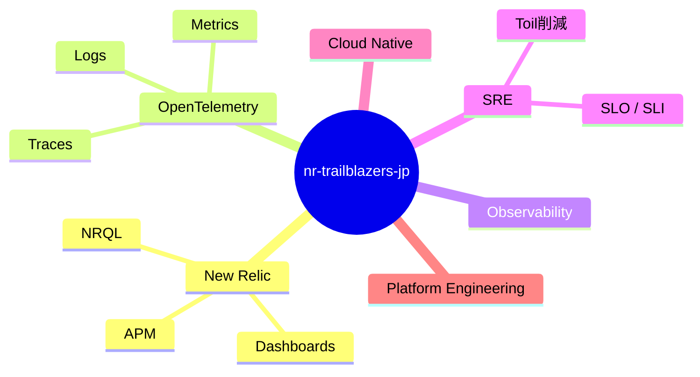
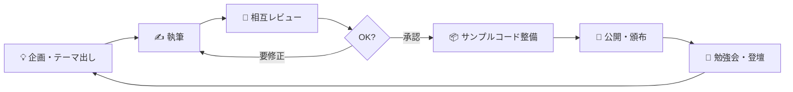

# 🚀 nr-trailblazers-jp

**New Relic Trailblazer 有志による技術同人誌・技術コンテンツ共同制作コミュニティ**

技術同人誌の執筆、サンプルコードの管理、勉強会・登壇資料の公開を通じて、
オブザーバビリティに関する知見をみんなで育てていくコミュニティです。

 

---

## 📚 活動内容

| 活動 | 内容 |
| :-- | :-- |
| ✍️ **技術同人誌の執筆・レビュー** | 有志による執筆と相互レビューで一冊を仕上げます |
| 💻 **サンプルコードの管理** | 書籍・資料で扱うサンプルコードを継続的にメンテナンス |
| 🎤 **勉強会・登壇資料の公開** | イベントでの登壇スライドや資料をオープンに共有 |
| 📡 **情報発信** | オブザーバビリティ関連技術の最新知見を発信 |

---

## 🧭 主なテーマ

---

## 🔄 コンテンツ制作の流れ

---

## 🤝 参加について

New Relic / OpenTelemetry / オブザーバビリティに興味のある方なら誰でも歓迎です。
執筆・レビュー・コード・運営など、関わり方は自由です。

---

> [!NOTE]
> 本 Organization はコミュニティ活動のためのものであり、**New Relic 社の公式組織ではありません。**
